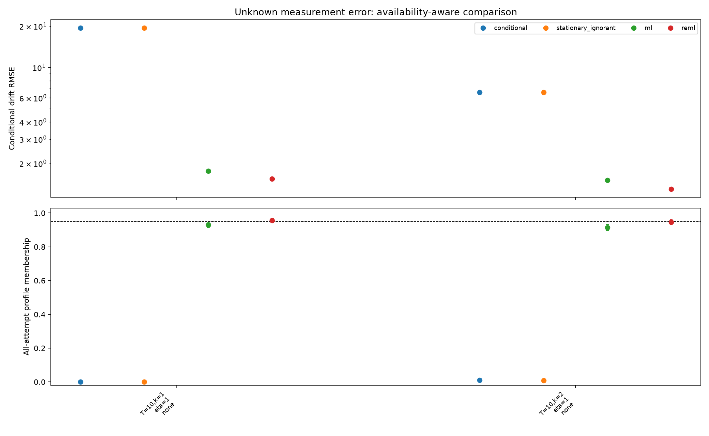

# Executed noisy-OU study

[Protocol](../../PROTOCOL.md) · [Derivations](../../THEORY.md) · [Summary](summary.json) · [Every record](replications.csv.gz) · [Optimizer audit](optimizer_audit.json)

Seed 20261018; 1000 attempts/design; total scalar-reading budget 200; nominal level 0.95.

ML and REML estimate unknown sensor variance using the full joint Gaussian law. Profile coverage uses an asymptotic cutoff, not a finite-sample guarantee. Different designs have independent data; methods within each record are paired. All RMSE values below are conditional on an available point estimate.

| Design | Conditional OLS RMSE (n) | Stationary noise-ignored RMSE (n) | Noisy ML RMSE (n) | Noisy REML RMSE (n) |
| --- | --- | --- | --- | --- |
| T=10,k=1,eta=1,stress=none | 19.4352 (1000) | 19.4257 (994) | 1.7563 (998) | 1.5394 (973) |
| T=10,k=2,eta=1,stress=none | 6.5930 (1000) | 6.5843 (992) | 1.5114 (999) | 1.2986 (983) |

Conditional bias, RMSE MC SE and paired squared-error differences are in summary.json. Methods with different availability populations cannot be ranked from conditional RMSE alone.

## Profile membership and availability

| Design | OLS profile, all | Noise-ignored profile, all | Noisy ML conditional / all (available n) | Noisy REML conditional / all (available n) |
| --- | --- | --- | --- | --- |
| T=10,k=1,eta=1,stress=none | 0.0000 | 0.0000 | 0.9319 / 0.9300 (998) | 0.9589 / 0.9570 (998) |
| T=10,k=2,eta=1,stress=none | 0.0100 | 0.0080 | 0.9149 / 0.9140 (999) | 0.9460 / 0.9460 (1000) |

All-attempt values count unavailable membership as failure. Conditional denominators, Wilson intervals and MC SEs are saved. White-noise limits can lack a finite point estimate while still admitting profile membership. Full-set endpoints and widths are not measured.

## Diagnostics

| Design | ML white / cap / nonconvergence / LR gap / exceptions | REML white / cap / nonconvergence / LR gap / exceptions |
| --- | --- | --- |
| T=10,k=1,eta=1,stress=none | 0 / 0 / 2 / 0 / 0 | 0 / 25 / 2 / 0 / 0 |
| T=10,k=2,eta=1,stress=none | 0 / 0 / 1 / 0 / 0 | 0 / 17 / 0 / 0 / 0 |

Independent optimizer audit discrepancies >1e-4: **0**. Audits are numerical comparisons, not global optimization certificates.

## Equal-budget local information

| Design | Efficient theta information | Local unbiased SE bound |
| --- | --- | --- |
| T=10,k=1,eta=1,stress=none | 2.5585 | 0.6252 |
| T=10,k=2,eta=1,stress=none | 2.6763 | 0.6113 |

This local bound applies to regular unbiased estimators at interior true parameters. It is not a universal bound on biased-estimator RMSE, and does not assert that replication wins for all designs.

## Weak-signal two-point illustration

| Signal fraction | KL(1 to 2) | TV upper bound | Size-0.05 power upper bound | Both-drift confidence membership lower bound |
| --- | --- | --- | --- | --- |
| 1.0000 | 8.5231 | 1.0000 | 1.0000 | 0.0000 |
| 0.8000 | 2.0172 | 1.0000 | 1.0000 | 0.0000 |
| 0.5000 | 0.7088 | 0.5953 | 0.6453 | 0.3047 |
| 0.2000 | 0.2291 | 0.3169 | 0.3669 | 0.5831 |
| 0.1000 | 0.1057 | 0.2131 | 0.2631 | 0.6869 |
| 0.0500 | 0.0433 | 0.1384 | 0.1884 | 0.7616 |
| 0.0100 | 0.0031 | 0.0386 | 0.0886 | 0.8614 |
| 0.0000 | 0.0000 | 0.0000 | 0.0500 | 0.9000 |

Two alternatives theta=1 and 2, dt=0.1, 101 sites, same unit total variance and signal fraction. These population bounds illustrate a submodel and do not validate fitted intervals. The gamma=0 row is a white-noise limit.

## Scope

- Sensor noise is independent Gaussian and initial states stationary, except explicitly labeled diagnostics.
- Correcting the likelihood does not by itself ensure short-window, boundary or weak-signal calibration.
- Equal budget means scalar reading count; timing costs and real sensor constraints are excluded.
- Established likelihood/REML/information tools are credited. Originality and journal suitability have not been established.
