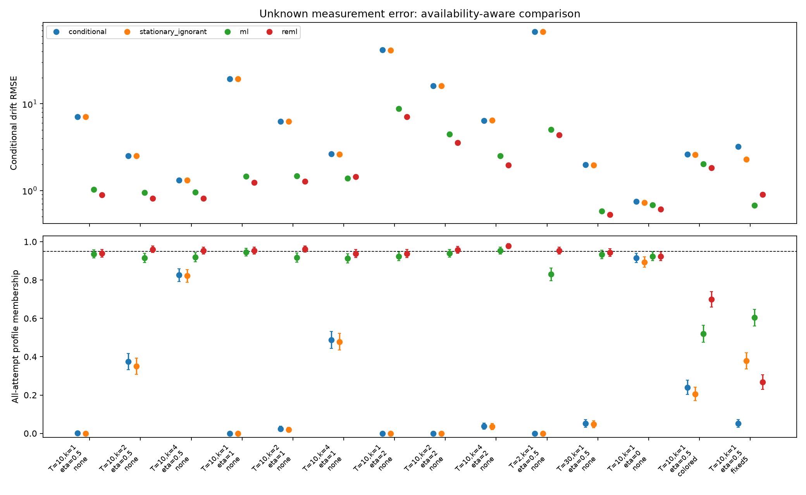

# Executed noisy-OU study

[Protocol](../../PROTOCOL.md) · [Derivations](../../THEORY.md) · [Summary](summary.json) · [Every record](replications.csv.gz) · [Optimizer audit](optimizer_audit.json)

Seed 20261015; 500 attempts/design; total scalar-reading budget 200; nominal level 0.95.

ML and REML estimate unknown sensor variance using the full joint Gaussian law. Profile coverage uses an asymptotic cutoff, not a finite-sample guarantee. Different designs have independent data; methods within each record are paired. All RMSE values below are conditional on an available point estimate.

| Design | Conditional OLS RMSE (n) | Stationary noise-ignored RMSE (n) | Noisy ML RMSE (n) | Noisy REML RMSE (n) |
| --- | --- | --- | --- | --- |
| T=10,k=1,eta=0.5,stress=none | 7.0838 (500) | 7.0879 (495) | 1.0310 (498) | 0.8882 (490) |
| T=10,k=2,eta=0.5,stress=none | 2.5178 (500) | 2.5044 (496) | 0.9456 (499) | 0.8074 (497) |
| T=10,k=4,eta=0.5,stress=none | 1.3146 (500) | 1.3105 (498) | 0.9585 (499) | 0.8146 (496) |
| T=10,k=1,eta=1,stress=none | 19.3745 (500) | 19.3713 (499) | 1.4597 (498) | 1.2321 (487) |
| T=10,k=2,eta=1,stress=none | 6.2801 (500) | 6.2747 (498) | 1.4659 (500) | 1.2751 (492) |
| T=10,k=4,eta=1,stress=none | 2.6488 (499) | 2.6103 (495) | 1.3798 (499) | 1.4437 (487) |
| T=10,k=1,eta=2,stress=none | 41.9260 (487) | 41.5592 (484) | 8.7767 (499) | 7.0914 (477) |
| T=10,k=2,eta=2,stress=none | 16.0703 (477) | 16.0703 (476) | 4.4645 (488) | 3.5431 (467) |
| T=10,k=4,eta=2,stress=none | 6.4219 (480) | 6.4259 (479) | 2.5192 (475) | 1.9681 (451) |
| T=2,k=1,eta=0.5,stress=none | 67.8750 (500) | 67.9882 (494) | 5.0364 (497) | 4.3687 (418) |
| T=30,k=1,eta=0.5,stress=none | 1.9775 (500) | 1.9649 (498) | 0.5787 (497) | 0.5282 (497) |
| T=10,k=1,eta=0,stress=none | 0.7474 (500) | 0.7258 (488) | 0.6811 (497) | 0.6078 (485) |
| T=10,k=1,eta=0.5,stress=colored | 2.6077 (500) | 2.5959 (490) | 2.0252 (496) | 1.8261 (499) |
| T=10,k=1,eta=0.5,stress=fixed5 | 3.2265 (500) | 2.2787 (492) | 0.6775 (495) | 0.8961 (177) |

Conditional bias, RMSE MC SE and paired squared-error differences are in summary.json. Methods with different availability populations cannot be ranked from conditional RMSE alone.

## Profile membership and availability

| Design | OLS profile, all | Noise-ignored profile, all | Noisy ML conditional / all (available n) | Noisy REML conditional / all (available n) |
| --- | --- | --- | --- | --- |
| T=10,k=1,eta=0.5,stress=none | 0.0020 | 0.0000 | 0.9398 / 0.9360 (498) | 0.9572 / 0.9400 (491) |
| T=10,k=2,eta=0.5,stress=none | 0.3740 | 0.3500 | 0.9178 / 0.9160 (499) | 0.9619 / 0.9600 (499) |
| T=10,k=4,eta=0.5,stress=none | 0.8260 | 0.8220 | 0.9218 / 0.9200 (499) | 0.9540 / 0.9540 (500) |
| T=10,k=1,eta=1,stress=none | 0.0000 | 0.0000 | 0.9498 / 0.9460 (498) | 0.9578 / 0.9540 (498) |
| T=10,k=2,eta=1,stress=none | 0.0240 | 0.0200 | 0.9180 / 0.9180 (500) | 0.9620 / 0.9620 (500) |
| T=10,k=4,eta=1,stress=none | 0.4880 | 0.4780 | 0.9140 / 0.9140 (500) | 0.9380 / 0.9380 (500) |
| T=10,k=1,eta=2,stress=none | 0.0000 | 0.0000 | 0.9240 / 0.9240 (500) | 0.9380 / 0.9380 (500) |
| T=10,k=2,eta=2,stress=none | 0.0000 | 0.0000 | 0.9419 / 0.9400 (499) | 0.9580 / 0.9580 (500) |
| T=10,k=4,eta=2,stress=none | 0.0380 | 0.0360 | 0.9559 / 0.9540 (499) | 0.9780 / 0.9780 (500) |
| T=2,k=1,eta=0.5,stress=none | 0.0000 | 0.0000 | 0.8350 / 0.8300 (497) | 0.9617 / 0.9540 (496) |
| T=30,k=1,eta=0.5,stress=none | 0.0520 | 0.0480 | 0.9396 / 0.9340 (497) | 0.9497 / 0.9440 (497) |
| T=10,k=1,eta=0,stress=none | 0.9160 | 0.8940 | 0.9296 / 0.9240 (497) | 0.9506 / 0.9240 (486) |
| T=10,k=1,eta=0.5,stress=colored | 0.2400 | 0.2060 | 0.5242 / 0.5200 (496) | 0.7014 / 0.7000 (499) |
| T=10,k=1,eta=0.5,stress=fixed5 | 0.0520 | 0.3780 | 0.6101 / 0.6040 (495) | 0.2724 / 0.2680 (492) |

All-attempt values count unavailable membership as failure. Conditional denominators, Wilson intervals and MC SEs are saved. White-noise limits can lack a finite point estimate while still admitting profile membership. Full-set endpoints and widths are not measured.

## Diagnostics

| Design | ML white / cap / nonconvergence / LR gap / exceptions | REML white / cap / nonconvergence / LR gap / exceptions |
| --- | --- | --- |
| T=10,k=1,eta=0.5,stress=none | 0 / 0 / 2 / 0 / 0 | 0 / 1 / 9 / 0 / 0 |
| T=10,k=2,eta=0.5,stress=none | 0 / 0 / 1 / 0 / 0 | 0 / 2 / 1 / 0 / 0 |
| T=10,k=4,eta=0.5,stress=none | 0 / 0 / 1 / 0 / 0 | 0 / 4 / 0 / 0 / 0 |
| T=10,k=1,eta=1,stress=none | 0 / 0 / 2 / 0 / 0 | 0 / 11 / 2 / 0 / 0 |
| T=10,k=2,eta=1,stress=none | 0 / 0 / 0 / 0 / 0 | 0 / 8 / 0 / 0 / 0 |
| T=10,k=4,eta=1,stress=none | 1 / 0 / 0 / 0 / 0 | 0 / 13 / 0 / 0 / 0 |
| T=10,k=1,eta=2,stress=none | 1 / 0 / 0 / 0 / 0 | 0 / 23 / 0 / 0 / 0 |
| T=10,k=2,eta=2,stress=none | 11 / 0 / 1 / 0 / 0 | 8 / 25 / 0 / 0 / 0 |
| T=10,k=4,eta=2,stress=none | 24 / 0 / 1 / 0 / 0 | 14 / 35 / 0 / 0 / 0 |
| T=2,k=1,eta=0.5,stress=none | 0 / 0 / 3 / 0 / 0 | 0 / 78 / 4 / 0 / 0 |
| T=30,k=1,eta=0.5,stress=none | 0 / 0 / 3 / 0 / 0 | 0 / 0 / 3 / 0 / 0 |
| T=10,k=1,eta=0,stress=none | 0 / 0 / 3 / 0 / 0 | 0 / 1 / 14 / 0 / 0 |
| T=10,k=1,eta=0.5,stress=colored | 0 / 0 / 4 / 0 / 0 | 0 / 0 / 1 / 0 / 0 |
| T=10,k=1,eta=0.5,stress=fixed5 | 0 / 0 / 5 / 0 / 0 | 0 / 315 / 8 / 0 / 0 |

Independent optimizer audit discrepancies >1e-4: **0**. Audits are numerical comparisons, not global optimization certificates.

## Equal-budget local information

| Design | Efficient theta information | Local unbiased SE bound |
| --- | --- | --- |
| T=10,k=1,eta=0.5,stress=none | 3.5919 | 0.5276 |
| T=10,k=2,eta=0.5,stress=none | 3.8725 | 0.5082 |
| T=10,k=4,eta=0.5,stress=none | 3.8367 | 0.5105 |
| T=10,k=1,eta=1,stress=none | 2.5585 | 0.6252 |
| T=10,k=2,eta=1,stress=none | 2.6763 | 0.6113 |
| T=10,k=4,eta=1,stress=none | 2.8451 | 0.5929 |
| T=10,k=1,eta=2,stress=none | 1.3203 | 0.8703 |
| T=10,k=2,eta=2,stress=none | 1.3520 | 0.8600 |
| T=10,k=4,eta=2,stress=none | 1.4440 | 0.8322 |
| T=2,k=1,eta=0.5,stress=none | 1.1739 | 0.9230 |
| T=30,k=1,eta=0.5,stress=none | 6.9351 | 0.3797 |

This local bound applies to regular unbiased estimators at interior true parameters. It is not a universal bound on biased-estimator RMSE, and does not assert that replication wins for all designs.

## Weak-signal two-point illustration

| Signal fraction | KL(1 to 2) | TV upper bound | Size-0.05 power upper bound | Both-drift confidence membership lower bound |
| --- | --- | --- | --- | --- |
| 1.0000 | 8.5231 | 1.0000 | 1.0000 | 0.0000 |
| 0.8000 | 2.0172 | 1.0000 | 1.0000 | 0.0000 |
| 0.5000 | 0.7088 | 0.5953 | 0.6453 | 0.3047 |
| 0.2000 | 0.2291 | 0.3169 | 0.3669 | 0.5831 |
| 0.1000 | 0.1057 | 0.2131 | 0.2631 | 0.6869 |
| 0.0500 | 0.0433 | 0.1384 | 0.1884 | 0.7616 |
| 0.0100 | 0.0031 | 0.0386 | 0.0886 | 0.8614 |
| 0.0000 | 0.0000 | 0.0000 | 0.0500 | 0.9000 |

Two alternatives theta=1 and 2, dt=0.1, 101 sites, same unit total variance and signal fraction. These population bounds illustrate a submodel and do not validate fitted intervals. The gamma=0 row is a white-noise limit.

## Scope

- Sensor noise is independent Gaussian and initial states stationary, except explicitly labeled diagnostics.
- Correcting the likelihood does not by itself ensure short-window, boundary or weak-signal calibration.
- Equal budget means scalar reading count; timing costs and real sensor constraints are excluded.
- Established likelihood/REML/information tools are credited. Originality and journal suitability have not been established.
