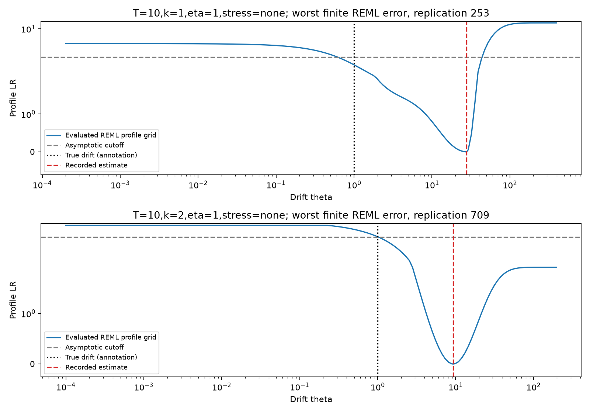

# Drift inference with unknown sensor noise: likelihood calibration and information limits

**Computational working manuscript, 2026-10-15.** Authorship and affiliations
are unassigned. All observations are synthetic. The methods and general
information tools are established; this manuscript does not establish an
original methodological contribution, journal suitability or acceptance.

## Abstract

We study stationary scalar Ornstein–Uhlenbeck drift inference when equilibrium
mean, latent stationary variance and independent Gaussian sensor-noise variance
are unknown. Exact full Gaussian ML and REML are compared with conditional
regression and a stationary noise-ignored likelihood. Site means and within-site
contrasts provide an exact reduction for replicated observations, and a
tridiagonal covariance identity evaluates each objective in linear time.
The main design has 7,000 records across 14 scenarios at a budget of 200 scalar
readings; independent confirmation adds 2,000 new records. We report procedure
availability, conditional estimation error, all-attempt profile membership,
Monte Carlo uncertainty, optimizer audits and untrimmed error-tail diagnostics.
Correct noise modeling reduces the large errors of the ignored-noise baselines,
but the asymptotic profile cutoff does not provide uniform finite-sample
calibration. Final confirmation gives ML all-attempt membership 93.0% and 91.4%, and REML 95.7% and 94.6%, for one and two readings per time, respectively.
A Gaussian KL/two-point argument explains why weak signal limits both test
power and the informativeness of any uniformly covering set. Equal-budget
replication yields modest local-information gains in the displayed scenarios;
it is not an unconditional empirical winner. The study supplies auditable
baselines and limitations for a future noise-aware calibration method.

Keywords: Ornstein–Uhlenbeck; measurement error; restricted likelihood;
finite-window inference; identifiability; sampling design.

## 1. Scientific question and prior work

The question is whether correctly modeling sensor noise is sufficient for
useful drift inference over a short observation window, and how observation
allocation affects the remaining uncertainty. Sampling more densely,
extending duration and repeating a measurement are different interventions.
A high coverage percentage can also conceal uninformative sets or failure to
produce a finite point estimate.

[Chen, Simpson and Ying (2000)](https://www3.stat.sinica.edu.tw/statistica/oldpdf/A10n17.pdf)
already analyze the OU-plus-white-noise covariance model and fixed-domain
inference. Infill results concern the identifiable product V*theta when both
covariance parameters are unknown; they are not a promise of separate drift
consistency at a fixed observation horizon.
[Holý and Tomanová](https://arxiv.org/abs/1811.09312) study noisy OU estimation
and the ARMA representation, while
[Calderon (2013)](https://arxiv.org/abs/1304.4196) addresses finite-sample noise
and bias. REML is an established variance-component construction, credited to
[Patterson and Thompson (1971)](https://doi.org/10.1093/biomet/58.3.545).
[Li, Kenney and Gu (2026)](https://arxiv.org/abs/2605.01262) provide a recent
factor OU state-space model, Kalman likelihood and environmental applications.
This scalar study does not reproduce or supersede their multivariate model.
The [selected literature review](../LITERATURE.md) also identifies prior
sampling/replication work that needs a full priority comparison.

The contributions claimed here are computational and expository: an audited
implementation, explicit model-specific derivations, fixed-budget comparisons,
an independent confirmation and transparent negative results. Existing
likelihood, REML, KL, Pinsker and two-point principles are not presented as new.

## 2. Model, likelihood and numerical inference

We observe Y_ij=X_(i*Delta)+epsilon_ij at m equally spaced sites and k readings
per site, with stationary Gaussian OU X and mutually independent Gaussian
sensor errors, independent of X. Let V=sigma^2/(2*theta), phi=exp(-theta*Delta),
s^2=V+eta^2 and gamma=V/s^2. Raw covariance is

$$s^2[\gamma R_\phi\otimes J_k+(1-\gamma)I_{mk}],
\qquad (R_\phi)_{ij}=\phi^{|i-j|}.$$

Noisy observations are not AR(1): the residual after subtracting phi times
the preceding observation includes epsilon_i-phi*epsilon_(i-1), giving adjacent
error covariance -phi*eta^2. Our noisy likelihood uses the full joint density,
not a product of densities conditioning only on the preceding noisy reading.

Let barY denote site means, W within-site residual sum of squares, d=m(k-1),
and A=gamma*R_phi+(1-gamma)/k*I. Gaussian orthogonal contrasts give independent
barY~N(mu*1,s^2*A) and W/eta^2~chi-square(d). GLS removes the unknown mean.
With S equal to the averaged-data GLS residual quadratic plus W/(1-gamma),
the shape log determinant is L=log|A|+m*log(k)+d*log(1-gamma). The profiled
objectives are

$$\ell_{ML}=\tfrac12[L+N\{\log(2\pi S/N)+1\}],$$

$$\ell_{REML}=\tfrac12[L+\log(\mathbf1^TA^{-1}\mathbf1)
+(N-1)\{\log(2\pi S/(N-1))+1\}].$$

For k=1 omit the within-site terms. REML removes one mean degree of freedom;
it does not make optimized covariance-shape estimates universally unbiased.
At k>1, exactly zero within-site variation is a singular likelihood boundary
and is rejected by this fitter. Replicated designs have positive noise variance.

Write q=1-phi^2, Q=q*R_phi^{-1}, and H=gamma*q*I+(1-gamma)/k*Q. Q and H
are tridiagonal. Since A^{-1}=H^{-1}Q and log|A|=log|H|-log(q), banded
Cholesky evaluates the objectives in O(m) work. The [full derivations](../measurement-error/THEORY.md)
include determinant, likelihood, information and testing arguments.

The fixed numerical algorithm profiles the nuisance fraction at each coarse
drift seed, then uses three bounded local starts, an innovation/noise-coordinate search and an explicit lower-drift
cap profile. Bounds on theta*Delta are [1e-5,20], with the phi=0 limiting model
also checked. White limits and cap solutions have no reported finite drift
estimate. In k=1 white-limit records, latent/sensor variance decomposition is
also unavailable. Nonconvergence and profile likelihood gaps are retained;
"ML" denotes numerical optimization of that objective, not a certificate of
its global maximizer. The truth never supplies a point-fit initial value.

True-drift membership in ML/REML profile sets uses a chi-square(1) cutoff.
It is asymptotic and may fail at short windows, weak signal or boundaries.
We measure true-point membership on each record; full endpoints and width
populations are not calculated. The preceding [noise-free stationary rank
construction](FINITE_SAMPLE_SUPPLEMENT.md) has different assumptions and does
not supply a finite-sample guarantee for the noisy procedures here.

## 3. Information limits

### 3.1 Local information with replicated readings

For C=V*R_phi+eta^2/k*I and beta=(theta,V,eta^2), derivatives are
C_theta=-V*D elementwise R_phi, C_V=R_phi and C_eta2=I/k, where
D_ij=Delta*|i-j|. At interior parameters,

$$I_{ab}=\tfrac12\operatorname{tr}(C^{-1}C_aC^{-1}C_b)
+\mathbf1_{a=b=\eta^2}\frac{m(k-1)}{2\eta^4}.$$

The trace is Gaussian covariance-score information. Independent within-site
contrasts contribute the additional noise-variance information; mean scores
are orthogonal in expectation. Eliminating the variance nuisance block by a
Schur complement gives I_eff. Its reciprocal is a local variance benchmark
for regular unbiased estimators, not a universal bound on finite-sample RMSE.
Increasing k at N=m*k fixed sacrifices distinct observation times while
adding independent information about sensor variance.

### 3.2 Weak-signal two-point bound

For two slopes at the same mean, signal fraction gamma and unit total variance,
put P=gamma*R0+(1-gamma)*I and Q=gamma*R1+(1-gamma)*I. Gaussian KL is

$$D(P\Vert Q)=\tfrac12[\operatorname{tr}(Q^{-1}P)-m+\log|Q|-\log|P|].$$

For gamma<1,

$$D(P\Vert Q)\le\frac{\gamma^2\|R_0-R_1\|_F^2}{4(1-\gamma)^2}.$$

**Argument.** KL is one half the Bregman divergence of -log determinant.
Its Hessian in direction E is at most ||E||_F^2/(1-gamma)^2 along the
covariance line segment. Taylor's integral remainder contributes a second
factor 1/2. Set E=gamma*(R0-R1). The Frobenius square is
2*sum_h(m-h)*(phi0^h-phi1^h)^2. The [proof and scope](../measurement-error/THEORY.md)
state the admissible submodel explicitly; this uses standard information tools.

Pinsker gives TV<=delta=min(1,sqrt(min(KL(P||Q),KL(Q||P))/2)). A size-alpha
test has power at most alpha+delta against the second alternative. Any random
set covering both drifts with probability at least 1-alpha under their own
laws must contain both with probability at least 1-2*alpha-delta under P.
This follows by transferring the second coverage event using TV and applying
a union bound. A nearest-alternative classification argument also gives
worst-case error probability at least (1-delta)/2 at half the drift separation.
The bounds include independent inference randomization.

For theta=1 versus 2, Delta=0.1 and 101 single-reading sites, gamma=0.01 gives
a power upper bound **0.0886** at size 0.05. A procedure valid at both parameter
points must contain both drifts with probability at least **0.8614** under the
first law. This illustrates unavoidable diameter loss in a weak-signal
submodel, not the actual coverage or power of the fitted likelihood methods.

## 4. Simulation design and audit history

The [internal protocol](../measurement-error/PROTOCOL.md) specifies 500 records
per main design. Nine designs cross k=1,2,4 with noise SD 0.5,1,2 at T=10,
using theta=1,mu=0,V=1 and N=200 scalar readings, including endpoints and
replicates. Other designs have T=2 or 30, a zero-noise boundary, colored sensor
error (AR coefficient 0.6), or fixed initial displacement +5 stationary SD.
Different designs have independent trajectories; methods share each record.
The noisy methods receive every replicate. Ignored-noise baselines receive
site averages, and the conditional/stationary contrast separates initial-law
handling from noise modeling.

Initial numerical audits identified a suboptimal REML ridge solution and a
missed low-signal mode. In the latter case, both local search and differential
evolution agreed on the inferior mode; a profile diagnostic exposed it. The
[amendment log](../measurement-error/AMENDMENTS.md) retains both diagnostics,
records repairs, and excludes viewed seeds 20261016 and 20261017 from
confirmatory evidence. Final main data are rerun with the repaired source.
Final confirmation uses untouched seed **20261018**, 1,000 records each for
k=1 and 2, T=10 and noise SD 1; it is separate from main and is not used for
algorithm tuning. Internal protocols and amendments are not preregistration.

Every attempt is archived. Point error summaries condition on finite available
estimates; membership is reported both among available numerical tests and
as all-attempt success-and-coverage. Wilson intervals, MC SE and matched-point
paired MSE differences use their stated denominators. No finite replacement
is assigned to failures. Cap/white/optimizer counts, nuisance estimates,
objectives and shape values permit numerical auditing. No tail is trimmed.

## 5. Executed results

### 5.1 Main design: conditional estimation error and membership

All rows have 500 attempts. Error values condition on each method's own finite point-estimate population; n is shown. Profile figures are all-attempt proportions, counting unavailable tests as failure.

| Design | Noisy ML RMSE (n) | REML RMSE (n) | ML membership | REML membership |
| --- | --- | --- | --- | --- |
| T=10,k=1,eta=0.5,stress=none | 1.0310 (498) | 0.8882 (490) | 0.9360 | 0.9400 |
| T=10,k=2,eta=0.5,stress=none | 0.9456 (499) | 0.8074 (497) | 0.9160 | 0.9600 |
| T=10,k=4,eta=0.5,stress=none | 0.9585 (499) | 0.8146 (496) | 0.9200 | 0.9540 |
| T=10,k=1,eta=1,stress=none | 1.4597 (498) | 1.2321 (487) | 0.9460 | 0.9540 |
| T=10,k=2,eta=1,stress=none | 1.4659 (500) | 1.2751 (492) | 0.9180 | 0.9620 |
| T=10,k=4,eta=1,stress=none | 1.3798 (499) | 1.4437 (487) | 0.9140 | 0.9380 |
| T=10,k=1,eta=2,stress=none | 8.7767 (499) | 7.0914 (477) | 0.9240 | 0.9380 |
| T=10,k=2,eta=2,stress=none | 4.4645 (488) | 3.5431 (467) | 0.9400 | 0.9580 |
| T=10,k=4,eta=2,stress=none | 2.5192 (475) | 1.9681 (451) | 0.9540 | 0.9780 |
| T=2,k=1,eta=0.5,stress=none | 5.0364 (497) | 4.3687 (418) | 0.8300 | 0.9540 |
| T=30,k=1,eta=0.5,stress=none | 0.5787 (497) | 0.5282 (497) | 0.9340 | 0.9440 |
| T=10,k=1,eta=0,stress=none | 0.6811 (497) | 0.6078 (485) | 0.9240 | 0.9240 |
| T=10,k=1,eta=0.5,stress=colored | 2.0252 (496) | 1.8261 (499) | 0.5200 | 0.7000 |
| T=10,k=1,eta=0.5,stress=fixed5 | 0.6775 (495) | 0.8961 (177) | 0.6040 | 0.2680 |

The [complete main report](../measurement-error/results/main/report.md) includes both ignored-noise baselines, every failure count and local information. Conditional populations differ; this table alone does not rank unconditional estimator risk.

### 5.2 Independent confirmation

| Replicates k | OLS RMSE (n) | ML RMSE (MC SE; n) | REML RMSE (MC SE; n) | ML success-and-coverage [Wilson 95%] | REML success-and-coverage [Wilson 95%] |
| --- | --- | --- | --- | --- | --- |
| 1 | 19.4352 (1000) | 1.7563 (0.2241; 998) | 1.5394 (0.2478; 973) | 0.9300 [0.9125,0.9442] | 0.9570 [0.9426,0.9679] |
| 2 | 6.5930 (1000) | 1.5114 (0.0705; 999) | 1.2986 (0.0662; 983) | 0.9140 [0.8950,0.9298] | 0.9460 [0.9302,0.9584] |

Correct noise modeling substantially reduces the errors of the ignored-noise
baselines in these recorded designs. ML still undercovers in confirmation;
REML all-attempt values are around 95% and their Wilson intervals include 95%.
Neither result establishes uniform validity. Numerical availability is
separate from finite point-estimate availability, so a boundary set can still
contribute membership even with no finite drift estimate.

At k=1, REML minus ML MSE is **-0.7536**, paired MC SE **0.0743**, n=971. At k=2, REML minus ML MSE is **-0.6295**, paired MC SE **0.0474**, n=982. These comparisons condition on their common finite-point availability subsets and are not population-wide dominance claims.

### 5.3 Equal-budget replication and local information

At noise SD 1, k=1 and 2 have efficient information 2.5585 and 2.6763,
a gain of about 4.6%, with local unbiased SE benchmarks 0.6252 and 0.6113.
The k=4 information is 2.8451. These are population calculations for the
stated design, not realized accuracy improvements. The empirical RMSE ranking
varies by method, noise and tail realization, and availability populations
change. Different k designs are independent; within-record paired differences
must not be applied across k. No universal replication optimum is claimed.

### 5.4 Tail sensitivity

The [tail audit](../measurement-error/results/confirmation/tail_report.md)
retains every finite estimate and identifies the largest error records.
It is descriptive follow-up, added after the final records to explain
instability; it does not select or retune an estimator. Large RMSE MC SEs
indicate that a few outcomes can strongly affect squared-error averages. The
RMSE MC SE uses a delta approximation and can itself be unstable under
concentrated squared errors.

For T=10,k=1,eta=1,stress=none, REML's top five finite-estimate records account for **43.41%** of squared error; the median absolute error is **0.4787** and maximum **26.8458** (n=973).
For T=10,k=2,eta=1,stress=none, REML's top five finite-estimate records account for **16.29%** of squared error; the median absolute error is **0.5180** and maximum **8.3214** (n=983).

A robust error summary may be informative alongside RMSE, but no replacement
or trimmed winner is substituted for the fixed endpoint. The largest records
remain in the CSV. Finite error summaries also depend on the disclosed search
caps and the method's availability population.

The worst finite REML error in each final confirmation design was reconstructed
and examined by a separate differential-evolution search and an evaluated
profile grid. No objective discrepancy above 1e-4 or negative profile gap
below -1e-6 was detected in these two examples. These are **post hoc** checks,
additional to the 64 preselected audits; they never change scientific fits.
Earlier development diagnostics showed that agreement between optimizers can
still miss a better mode, so this is not a global certificate.
[Raw observations, selection metadata and profile grids](../measurement-error/results/confirmation/extreme_profiles.json)
make the check reproducible. The evaluated grid is not a certified continuous
confidence-set inversion and the examples are not representative draws.

### 5.5 Assumption stress and numerical failures

Colored error and a fixed initial state invalidate the fitted observation or
initial law. Their membership and failures are retained in the main table;
these runs are not evidence of robustness beyond assumptions. Particularly
poor fixed-start REML performance illustrates the importance of conditioning
and initial-law specification. Numerical nonconvergence and likelihood gaps
remain explicitly unavailable tests; selected independent optimizer audits
do not certify every fit or every point of parameter space.

## 6. Verification, reproducibility and limitations

The code has independent dense-Gaussian, Kalman-innovation, orthonormal-contrast,
full replicated-covariance Fisher derivative and Gaussian-KL references.
A regression test preserves the audited boundary failure's repair. CLI replay
checks identical compressed record archives. The full repository has **131
passing tests**. The final selected optimizer audits compare 56 main and eight
confirmation ML/REML fits with differential evolution; no objective discrepancy
exceeds 1e-4. This does not eliminate remaining per-record numerical failures
or prove global convergence. Proofs and numerical arithmetic are distinct.

[Main](../measurement-error/results/main/report.md),
[confirmation](../measurement-error/results/confirmation/report.md) and
[tail audits](../measurement-error/results/main/tail_report.md) retain results,
source/configuration/archive hashes, seeds, numerical versions and complete
records. The code requires Python 3.11 or newer. GitHub Actions runs both full
designs and their tail audits on Python 3.11, 3.13 and 3.14. Covariance coverage
is a result, not a software pass threshold. The main design and final
confirmation contain exactly **9,000 attempts**; discarded development runs
are not counted as independent evidence.

Limitations include the selected parameter range, equal spacing, Gaussian
independent sensor noise, stationary start, bounded numerical search and
limited optimizer auditing. Repeating observations has hardware and timing
costs not included in a scalar-reading budget. Full confidence widths,
power curves and finite-sample noisy coverage are not established. There is
no real-data application, external preregistration, archival DOI, independent
expert review or accepted journal contribution. Literature positioning is
selected rather than a systematic novelty certification.

## 7. Research implication

The calculations support separating modeling error, weak information,
calibration error and numerical failure. A correct sensor-noise likelihood
can improve estimation without guaranteeing nominal profile coverage.
Information bounds preclude a uniformly narrow confidence set in arbitrarily
weak signal, regardless of numerical effort. A useful next methodological
target would specify a signal-strength and sampling class, then prove both
coverage control and an attainable precision statement while retaining
boundary cases. It would require a focused priority review and comparisons
with the strongest published alternatives. The present study supplies
baselines for that question and does not claim to resolve it.

The [submission-readiness review](../SUBMISSION_READINESS_ZH.md) records
which evidence is complete and which claims remain open. Bibliographic
metadata are in [references.bib](references.bib).
